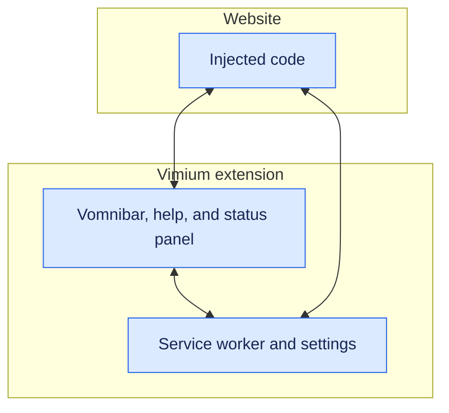
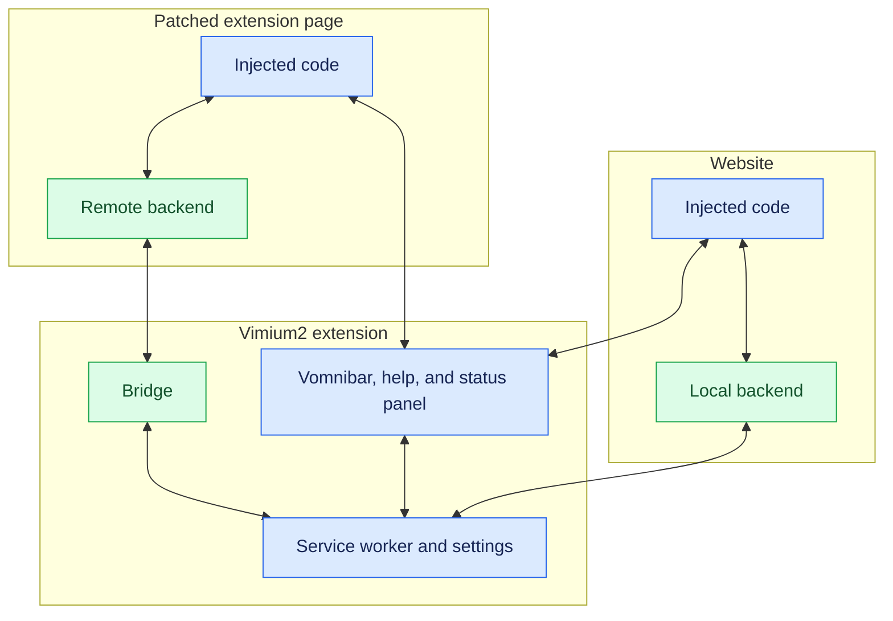

# Vimium2

[Vimium](https://github.com/philc/vimium), but also works inside other Chrome extensions.

Vimium's shortcuts don't work inside other extensions, such as PDF readers.
Vimium2 is a Vimium fork that makes it work.

## Background: How Vimium works



Vimium injects code into web pages, which listens for keyboard events.
Particularly for browser commands like switching or closing tabs and populating Vomnibar results, the injected code communicates with Vimium's service worker (background daemon).

However, Chrome extensions are isolated from each other, so Vimium can't automatically inject code into other extensions.

## How Vimium2 works

For regular websites, Vimium2 works the same way as Vimium.
For other extensions, you will one-time manually inject Vimium2's injected code which will then communicate with Vimium2's service worker via *cross-extension messaging*.

Blue components come from Vimium, with changes where needed.
Green components are added by Vimium2.



## Using Vimium2

> [!NOTE]
> If you landed here from the error message "Vimium2: This extension was patched for a different Vimium2 build.", it probably means that your Vimium2 and patched extension went out of sync. Rebuilding Vimium2, re-patching the extension(s), and reloading them should fix it.

Vimium2's architecture should in theory work with most extensions.
See [`integrations/`](integrations/) for officially supported extensions.

The overall patching process is:

1. Build Vimium2 and load it into Chrome.
1. Patch the target extension with Vimium2's injected code, and load it into Chrome.
1. Add the patched extension's ID to Vimium2's **Allowed Bridge Extensions**.

### 1. Build Vimium2 and load it into Chrome

You need [Deno 2](https://deno.com/) and Chrome (I haven't tested these on other Chromium-based browsers).

1. Clone this repository and build Vimium2: `deno task build`
1. Open `chrome://extensions` and turn on **Developer mode**.
1. If you have Vimium installed, disable it. Then, choose **Load unpacked** and select `dist/vimium2`.
1. Copy the extension ID from Vimium2's card.

### 2. Patch the target extension and load it into Chrome

`deno task patch [integration subdir]` will patch the target extension and create a new directory under `dist/` with the patched extension.

For instance, for Google Scholar PDF Reader:

```sh
deno task patch integrations/google-scholar-pdf-reader \
  --vimium-id VIMIUM2_ID --chrome-version CHROME_VERSION
```

Replace `VIMIUM2_ID` with Vimium2's ID from Step 1 or `chrome://extensions`, and `CHROME_VERSION` with the full version at `chrome://version` (e.g., `153.0.8010.36`).
This will download the target extension from Chrome Web Store for the supplied Chrome version, patch it, and print the directory of the patched extension.
You can also directly supply the extension to patch; see `deno task patch --help`.

Once patching is complete, navigate to `chrome://extensions` and load the patched extension with **Load unpacked**. You should disable/remove any original or previously patched version of the extension.

### 3. Add the patched extension's ID to Vimium2

You need to explicitly whitelist the patched extension from Vimium2's settings so that random (potentially malicious) extensions don't have access to Vimium2.

1. Copy the patched extension's new ID.
1. Open Vimium2's options, add that ID to **Allowed Bridge Extensions**, and save.
1. Reload the extension's tab. Vimium2 should now work.

## Adding integrations for other extensions

Each integration has its own directory under [`integrations/`](integrations/).
Its `integration.js` describes what to patch; an optional `page.js` contains code that runs inside the target extension.
Integrations currently support pages in tabs and embedded frames, but not popups or side panels.

## Acknowledgments

Vimium is awesome. I can't imagine life without it.

Ideally I want to upstream this idea to Vimium ([philc/vimium#4874](https://github.com/philc/vimium/issues/4874)), but it isn't making much progress.
